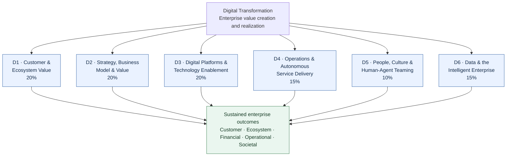
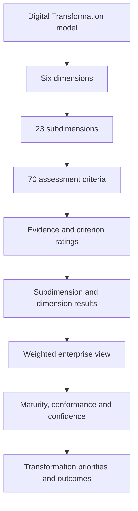
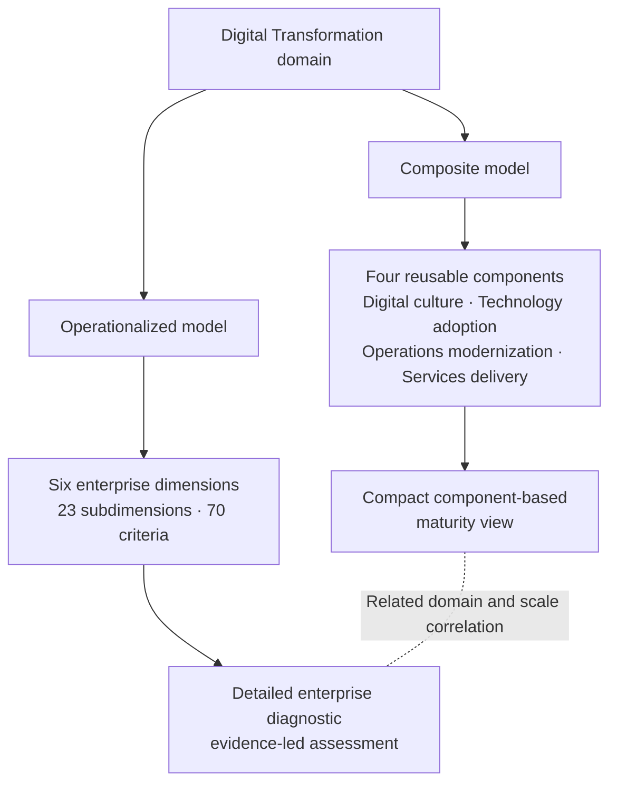
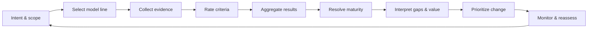
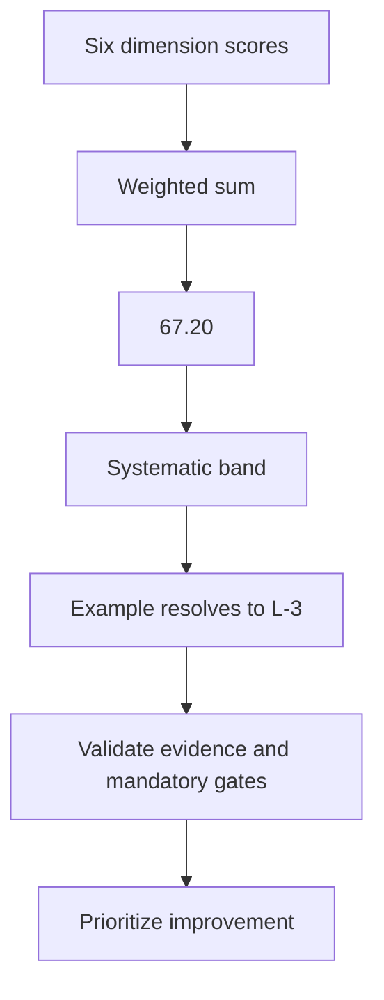
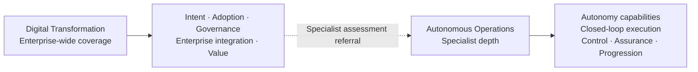

# Digital Transformation Maturity Model

**An enterprise-wide model for assessing how effectively an organization transforms its strategy, business model, customer and ecosystem relationships, operating capabilities, people, data and technology into sustained value.**

Digital transformation is not synonymous with technology adoption. New platforms, automation and AI may enable transformation, but maturity is demonstrated by the organization's ability to change how it creates, delivers and realizes value, and to sustain those changes through its operating model.

This repository contains two related but distinct model lines. The **Operationalized model** provides the detailed enterprise diagnostic. The **Composite model** provides a compact component-based assessment. They share a domain and aligned scale identifiers, but their criteria, evidence, scoring and results are not interchangeable.

---

## Start here

| If you are… | Start with… |
|---|---|
| Board member or executive | [Executive pathway](docs/guides/persona-guide.md#2-executive-and-board-pathway) |
| Digital / transformation leader | [Transformation leader pathway](docs/guides/persona-guide.md#3-transformation-leader-pathway) |
| Enterprise architect | [Architecture, technology and data pathway](docs/guides/persona-guide.md#4-architecture-technology-and-data-pathway) |
| Business or product leader | [Business, product and customer pathway](docs/guides/persona-guide.md#5-business-product-and-customer-pathway) |
| Operations leader | [Operations pathway](docs/guides/persona-guide.md#6-operations-pathway) |
| People / change leader | [People and change pathway](docs/guides/persona-guide.md#7-people-and-change-pathway) |
| Assessor | [Assessor pathway](docs/guides/persona-guide.md#8-assessor-pathway) |
| Model contributor | [Model maintainer pathway](docs/guides/persona-guide.md#9-model-maintainer-pathway) |

For a guided explanation, read the [assessment methodology](docs/methodology/assessment-methodology.md). For the current model-definition discrepancies and decisions required, read the [model reconciliation](docs/reconciliation/model-reconciliation.md).

## What does the model assess?

The Operationalized model treats digital transformation as a connected enterprise capability system. Its six dimensions are deliberately broader than IT modernization: customer and ecosystem value, strategic and business-model change, platforms, operations, people and data must reinforce one another.



| Dimension | Weight | What it examines |
|---|---:|---|
| **D1 · Customer & Ecosystem Value** | 20% | Customer and partner journeys, personalization, ecosystem participation, monetization and value |
| **D2 · Strategy, Business Model & Value** | 20% | Strategic intent, digital business models, investment and value logic, financial performance, sustainability and governance |
| **D3 · Digital Platforms & Technology Enablement** | 20% | Composable platforms, cloud-native foundations, AI/agent readiness, security, privacy and resilience |
| **D4 · Operations & Autonomous Service Delivery** | 15% | Service orchestration, assurance, operational modernization, automation and enterprise-level autonomy adoption |
| **D5 · People, Culture & Human-Agent Teaming** | 10% | Leadership, workforce skills, culture, organizational design, innovation and human-agent work |
| **D6 · Data & the Intelligent Enterprise** | 15% | Data architecture and products, governance, trust, sharing, decision intelligence and data-to-action capability |

The Operationalized register is declared as **six dimensions, 23 subdimensions and 70 assessment criteria**. The dimensions are weighted to 100%. D1–D4 are currently designated mandatory; D5–D6 optional. See the machine-readable evaluation and criteria register for the authoritative definition.

## How the model is structured

The assessment moves from enterprise-wide domains into increasingly specific and evidence-based judgments.



This hierarchy supports two complementary views:

- **Breadth:** a common enterprise-level view of transformation across the six dimensions.
- **Depth:** traceable criteria and evidence that explain why a dimension receives its assessment result.

A high-level score should always be explainable through the underlying criteria, evidence and assessment rationale.

## Two model lines, different assessment purposes



| Model line | Definition | Best suited to |
|---|---|---|
| **Composite** | `maturity/scale.yaml`, `maturity/evaluation.yaml` and `maturity/components/`; four component criteria | A compact, reusable composite view |
| **Operationalized** | `maturity/operationalized/`; six dimensions, 23 subdimensions and 70 criteria | Detailed enterprise-wide digital transformation assessment |

The scales record a 1:1 level correlation. This does **not** make the two model lines equivalent: criteria, evidence requirements, weights, evaluation logic and assessment scores remain model-line specific. Do not transfer or combine scores between them unless an approved mapping explicitly defines how.

## Maturity progression

Both scale artifacts define **L-0 Not Assessed** as a sentinel state, not a capability maturity level. The five capability maturity levels are L-1 through L-5.

The Operationalized scale associates the following value aliases and score bands with its five levels:

| Level | Value alias | Score band | Interpretation |
|---|---|---:|---|
| L-0 | Not Assessed | — | No evidence examined; not a maturity level |
| L-1 | Unrealized | 0–20 | Digital activity is informal and value is at risk |
| L-2 | Proven | 21–45 | Value is demonstrated in governed pilots, but adoption is uneven |
| L-3 | Standardized | 46–70 | Digital practices are governed and repeatable |
| L-4 | Compounding | 71–88 | Metrics-driven, predictive and adaptive capabilities scale value |
| L-5 | Leading | 89–100 | Intent-driven, self-optimizing practices set benchmarks |

The score bands and aliases above are read from the Operationalized scale. Its evaluation description currently contains an inconsistent L-0…L-4 resolution statement. The reconciliation is recorded in [REC-01](docs/reconciliation/model-reconciliation.md#4-scale-and-evaluation-reconciliation); do not treat the contradictory resolver description as settled.

## How an assessment works

The methodology is evidence-led. It should establish current operating reality, not simply collect statements of intent.



At a high level, the Operationalized evaluation describes this aggregation:

```text
Criterion ratings
    → subdimension means
    → dimension means
    → weighted overall score (0–100)
    → maturity-band and conformance resolution
    → evidence-backed improvement priorities
```

D1–D4 are currently mandatory. The detailed treatment of incomplete evidence, criterion rating conversion, confidence and highest-conformant-level resolution requires reconciliation in the model contract. The [Assessment Methodology](docs/methodology/assessment-methodology.md) explains the current process and explicitly identifies these limitations.

## Worked example: reading an assessment result

The repository includes an illustrative Operationalized assessment in `examples/operationalized-2026.yaml`.

| Dimension | Score | Weight | Contribution |
|---|---:|---:|---:|
| D1 | 72 | 0.20 | 14.40 |
| D2 | 64 | 0.20 | 12.80 |
| D3 | 58 | 0.20 | 11.60 |
| D4 | 70 | 0.15 | 10.50 |
| D5 | 80 | 0.10 | 8.00 |
| D6 | 66 | 0.15 | 9.90 |
| **Total** | | **1.00** | **67.20** |



The weighted arithmetic is 67.20. The example reports the Systematic band and L-3. It is an **illustration of the reported calculation**, not a validated organization assessment or benchmark. It supplies dimension scores directly and does not demonstrate the full criterion-level evidence and rating process. The example's effort-adjusted value of 168.0 is mathematically 67.2 × 2.5; its meaning and units remain subject to model reconciliation. It must not be interpreted as realized financial or enterprise value.

## The boundary with Autonomous Operations

Digital transformation includes the adoption and enterprise contribution of autonomous capabilities. D4 therefore considers operational modernization, service orchestration, assurance and the organization's movement toward autonomous service delivery.

It does not replace a specialist assessment of operational autonomy. When the question is how deeply operations can sense, analyze, decide, execute and verify autonomously, or how closed-loop behavior is controlled and assured, use the [Autonomous Operations Maturity Model](https://github.com/Assessment-Models/maturity-model-autonomous-operations).



The two assessments are complementary. A strong Digital Transformation result does not prove a particular level of autonomous operational capability.

## Who should use this model?

| Persona | Main use |
|---|---|
| **Board and executive leaders** | Understand strategic exposure, enterprise outcomes and investment priorities |
| **Digital and transformation leaders** | Establish a baseline, identify constraints and govern the transformation portfolio |
| **Enterprise architects** | Connect strategy, business capabilities, information, platforms and operating-model change |
| **Business and product leaders** | Assess customer journeys, ecosystem propositions and business-model value |
| **Operations leaders** | Assess modernization and enterprise adoption of autonomous service delivery |
| **Technology leaders** | Evaluate whether platforms, security and resilience enable the target operating model |
| **Data and AI leaders** | Assess trusted data, decision intelligence and AI/agent readiness |
| **People and change leaders** | Examine leadership, skills, culture and human-agent teaming |
| **Assessment practitioners** | Produce evidence-backed, traceable and reproducible assessments |
| **Model contributors** | Maintain model coherence, versioning, traceability and conformance |

See the full [Persona Guide](docs/guides/persona-guide.md) for role-specific questions, reading paths and expected outputs.

## Repository guide

| Location | Purpose |
|---|---|
| `model.yaml` | Repository model identity and contract handshake |
| `standard.yaml` | Repository-standard declaration and structure mapping |
| `maturity/scale.yaml` | Composite model scale |
| `maturity/evaluation.yaml` | Composite model evaluation |
| `maturity/components/` | Composite reusable component definitions |
| `maturity/operationalized/scale.yaml` | Operationalized model scale |
| `maturity/operationalized/evaluation.yaml` | Six-dimension Operationalized evaluation |
| `maturity/operationalized/model/` | Detailed subdimension and criterion register |
| `maturity/operationalized/components/` | Operationalized dimension components |
| `mappings/` | Cross-references and model-line mapping |
| `examples/` | Illustrative assessment examples |
| `docs/reconciliation/` | Artifact-level findings and decisions required |
| `docs/methodology/` | Assessment lifecycle and interpretation |
| `docs/guides/` | Persona-oriented navigation |
| `change-requests/` | Governed change proposals |

## Model status and governance

The repository is at release `2.0.0` and declares conformance to `AM-MODEL-REPOSITORY-STANDARD` v1.0.1 at structural level. The README and manifests identify the Composite line as stable and the Operationalized line as alpha. These are model/repository status declarations, not an assertion that every scoring and versioning discrepancy has been resolved.

The model is part of the Assessment-Models ecosystem and its conformance process. Machine-readable artifacts remain authoritative for model identity, dimensions, criteria, weights, scale and evaluation. Documentation explains those artifacts and must remain traceable to them.

### Current reconciliation priorities

- Align evaluation resolution descriptions with L-0 Not Assessed and L-1…L-5 capability maturity levels.
- Establish version authority across repository, model lines, scales, evaluations and examples.
- Specify criterion rating conversion, missing-data handling, evidence confidence and mandatory gates.
- Define the effort-adjusted value construct and reporting semantics.
- Add criterion-level worked examples and automated register consistency checks.

The detailed register is maintained in [Model Reconciliation](docs/reconciliation/model-reconciliation.md). The governing documentation proposal is [CR-DT-01](change-requests/CR-DT-01.md).

## Conformance and ecosystem

This repository demonstrates the Assessment-Models repository and model conformance approach, including local validation, contract conformance and registry reference checks. These mechanisms validate structural and interoperability expectations; they do not replace domain-specific assessment methodology or evidence quality.

- [Assessment-Models organization](https://github.com/Assessment-Models)
- [Maturity Model Repository Standard](https://github.com/Assessment-Models/maturity-model-standard)
- [Autonomous Operations Maturity Model](https://github.com/Assessment-Models/maturity-model-autonomous-operations)

---

*The Digital Transformation Maturity Model is intended to make enterprise transformation more assessable, explainable and actionable: from declared intent, through demonstrable capability, to sustained outcomes and continuous adaptation.*
