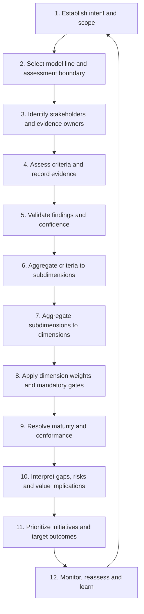
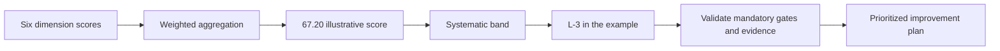

# Digital Transformation Assessment Methodology

**Status:** Explanatory methodology aligned to current repository artifacts. This document does not override the machine-readable evaluation contracts. Where the contracts are incomplete or inconsistent, the limitation is stated explicitly.

## 1. Assessment purpose

The Digital Transformation Maturity Model examines an organization's ability to deliberately transform how it creates, delivers and realizes value through changes to its strategy, business model, customer and ecosystem relationships, operating capabilities, people, data and technology.

It is not a technology-adoption checklist. Technology is an important enabler, but transformation must be assessed in terms of enterprise outcomes and the capabilities required to sustain them.

An assessment should produce more than a maturity label. It should establish:

- What outcomes the organization is seeking.
- What capabilities and operating practices exist today.
- How consistently those capabilities are applied.
- What evidence supports each finding.
- Where material gaps and dependencies remain.
- What changes are likely to improve value realization.
- Which questions require a deeper specialist assessment.

## 2. Choose the model line

| Use case | Model line |
|---|---|
| High-level composite view using four reusable components | Composite |
| Enterprise-wide diagnostic across six dimensions and detailed criteria | Operationalized |
| Detailed autonomous operations maturity, closed-loop execution and operational autonomy | Specialist Autonomous Operations model |

Do not combine scores from different model lines unless a formally governed mapping and aggregation method explicitly permits it.

## 3. Define assessment scope

Agree the organizational boundary before collecting evidence:

- Enterprise, business unit, product/service portfolio, value stream or operational domain.
- Geographic and regulatory boundaries.
- Included subsidiaries, partners and ecosystem dependencies.
- Assessment period and evidence cut-off date.
- Current operating context and target horizon.
- Strategic outcomes and transformation intent.
- Exclusions and their rationale.

Assess both the organization's **current operating reality** and its **future readiness**. These are related but distinct views. A strong target-state ambition does not prove current capability; current operational performance does not by itself prove readiness to transform.

## 4. The six Operationalized dimensions

| ID | Dimension | Weight | Assessment focus |
|---|---|---:|---|
| D1 | Customer & Ecosystem Value | 20% | Customer and partner journeys, personalization, ecosystem participation, monetization and value |
| D2 | Strategy, Business Model & Value | 20% | Strategic intent, digital business models, investment/value logic, financial performance, sustainability and governance |
| D3 | Digital Platforms & Technology Enablement | 20% | Composable platforms, cloud-native foundations, AI/agent readiness, security, privacy and resilience |
| D4 | Operations & Autonomous Service Delivery | 15% | Service orchestration, assurance, operational modernization, automation and enterprise-level autonomy adoption |
| D5 | People, Culture & Human-Agent Teaming | 10% | Leadership, workforce skills, culture, organizational design, innovation and human-agent work |
| D6 | Data & the Intelligent Enterprise | 15% | Data architecture, products, governance, trust, sharing, intelligence and decision-to-action capability |

D1–D4 are marked mandatory in the current evaluation artifact. D5–D6 are marked optional. The effect of an omitted optional dimension and the handling of an incomplete mandatory dimension must be confirmed in the normative evaluation contract.

## 5. Assessment lifecycle



### Step 1 — Establish intent and scope

Record the transformation objectives, target outcomes, organizational boundary, assessment period and intended use of the results.

### Step 2 — Select the model line

Choose Composite for a compact component-based view or Operationalized for the six-dimension enterprise diagnostic. Use the Autonomous Operations model when the question requires detailed assessment of autonomous execution and operational control.

### Step 3 — Identify stakeholders and evidence owners

Assign accountable owners for each dimension and criterion group. Include business, customer, operations, technology, data, risk, finance and workforce perspectives where relevant.

### Step 4 — Assess criteria and record evidence

For every applicable criterion, capture:

- Rating and rationale.
- Evidence artifact or source reference.
- Evidence owner and date.
- Organizational and process scope.
- Evidence quality, coverage and limitations.
- Assumptions, exceptions and contradictory evidence.

Do not infer a high maturity rating from strategy documents or declared intent alone. Look for demonstrated practice and outcomes.

### Step 5 — Validate findings and confidence

Review evidence with the relevant owners. Distinguish verified practice from self-reported activity, isolated pilots, untested claims and missing evidence.

The current scale defines L-0 Not Assessed as a non-maturity sentinel. An unassessed criterion must not automatically be interpreted as evidence that the capability is absent.

### Steps 6–8 — Aggregate results

The Operationalized evaluation describes this hierarchy:

```text
Criterion scores
    ↓ mean
Subdimension score
    ↓ mean
Dimension score
    ↓ weighted sum using dimension weights
Overall score (0–100)
```

At the dimension level, the current weights are:

```text
Overall score =
  (D1 × 0.20) +
  (D2 × 0.20) +
  (D3 × 0.20) +
  (D4 × 0.15) +
  (D5 × 0.10) +
  (D6 × 0.15)
```

The evaluation describes criterion ratings as 1–5 and scores as 0–100, but the complete conversion rule and treatment of missing or not-applicable responses need formal specification. Do not implement an assumed conversion in an assessment tool.

### Step 9 — Resolve maturity and conformance

The scale defines L-0 Not Assessed and five capability levels L-1 through L-5. The score bands in the Operationalized scale are:

| Level | Value alias | Score range |
|---|---|---:|
| L-1 | Unrealized | 0–20 |
| L-2 | Proven | 21–45 |
| L-3 | Standardized | 46–70 |
| L-4 | Compounding | 71–88 |
| L-5 | Leading | 89–100 |

The Operationalized evaluation description currently says L-0…L-4 resolution, which conflicts with its own L-1…L-5 expectations and scale. This must be corrected in the model definition before this table is treated as an executable resolution contract.

The model also declares D1–D4 mandatory. The precise mandatory-gate algorithm, evidence-confidence adjustment and highest-conformant-level calculation must be taken from the approved evaluation implementation once reconciled.

### Step 10 — Interpret gaps and value implications

A score is a diagnostic signal, not the transformation outcome. Interpret it against:

- Strategic outcomes and customer/ecosystem value.
- Business model viability and value capture.
- Operational performance, resilience and cost.
- Technology and data foundations.
- Workforce and organizational readiness.
- Risk, compliance and trust.
- Dependencies and constraints.

Separate maturity, readiness, operational performance and realized value in the assessment narrative. They should inform one another but should not be collapsed into a single unsupported construct.

### Steps 11–12 — Prioritize and improve

Translate findings into a sequenced improvement portfolio. Each initiative should state the capability gap, intended outcome, accountable owner, dependencies, investment, measures, evidence of completion and reassessment point.

Use the assessment as a recurring learning cycle, not a one-off ranking exercise.

## 6. Illustrative worked example

The repository's `examples/operationalized-2026.yaml` reports the following dimension scores:

| Dimension | Score | Weight | Weighted contribution |
|---|---:|---:|---:|
| D1 Customer & Ecosystem Value | 72 | 0.20 | 14.40 |
| D2 Strategy, Business Model & Value | 64 | 0.20 | 12.80 |
| D3 Digital Platforms & Technology Enablement | 58 | 0.20 | 11.60 |
| D4 Operations & Autonomous Service Delivery | 70 | 0.15 | 10.50 |
| D5 People, Culture & Human-Agent Teaming | 80 | 0.10 | 8.00 |
| D6 Data & the Intelligent Enterprise | 66 | 0.15 | 9.90 |
| **Overall** | | **1.00** | **67.20** |



This example is illustrative, not a benchmark. It supplies dimension scores directly and does not demonstrate criterion-level evidence or the full criterion-to-subdimension conversion. Its reported effort-adjusted value of 168.0 is arithmetically the product of 67.2 and 2.5, but its semantic meaning and units require clarification. Do not interpret 168.0 as enterprise value or as a score on the 0–100 domain.

## 7. Required assessment outputs

A defensible assessment report should include:

1. Executive summary and scope.
2. Transformation intent and target outcomes.
3. Model line and version used.
4. Dimension-level scorecard with mandatory/optional status.
5. Criterion-level ratings and evidence traceability.
6. Evidence confidence, gaps and limitations.
7. Maturity resolution and conformance status.
8. Current-state versus future-readiness observations.
9. Value, performance and risk implications.
10. Prioritized improvement portfolio.
11. Dependencies and specialist assessment referrals.
12. Assessment date, participants, reviewers and approval record.

## 8. Specialist assessment boundary

Digital Transformation provides an enterprise-wide view of whether autonomous capabilities are strategically positioned, adopted, governed and connected to value outcomes.

When the assessment needs to establish how deeply an operation can sense, analyze, decide, execute and verify autonomously, whether closed-loop behavior is safe and reliable, or how operational autonomy progresses, use the specialist Autonomous Operations model. Do not infer specialist autonomy maturity from a high D4 score.

## 9. Methodology limitations to resolve

The following are model-definition work, not editorial choices:

- Criterion rating 1–5 to score 0–100 conversion.
- Missing, unassessed and not-applicable treatment.
- Evidence-confidence calculation and effect on resolution.
- Mandatory-dimension gate and highest-conformant-level algorithm.
- Fractional score rounding and band boundary behavior.
- Effort-adjusted value definition and units.
- L-0…L-4 evaluation text versus L-1…L-5 scale.

See [Model Reconciliation](../reconciliation/model-reconciliation.md) and [CR-DT-01](../../change-requests/CR-DT-01.md).
